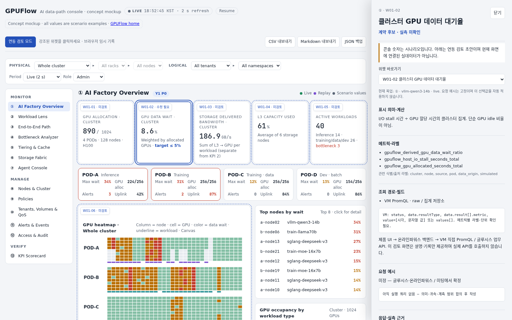

# 콘솔에서 메트릭·API 연동 검토하기

상태: 2026-11-07 글루시스 검토 초안. 화면에는 기존 시나리오 숫자가 표시됩니다. 검토 패널은 그 위젯에 필요한 데이터 계약을 설명하며 실제 API를 호출하지 않습니다.



## 미팅 사용 순서

1. 콘솔 상단 **연동 검토 모드**를 켭니다. 시나리오의 자동 갱신은 일시 정지됩니다.
2. 점선으로 강조된 위젯이나 `W01-02` 같은 번호 버튼을 클릭합니다. 검토 모드에서 해당 영역 클릭은 명세 선택으로 동작합니다. 원래 시나리오 조작은 검토 모드를 끈 뒤 사용합니다.
3. 오른쪽 패널에서 의미·계산식, 메트릭, API 경로·응답 필드, 요청 예시, 검증 요약, 제한·미결 사항을 확인합니다. 일부 쿼리는 **관련 원천 조회만 검증**되었으며 위젯의 완성 쿼리가 아닙니다.
4. 아래 회의 기록에 `미검토 / 합의 (회의 기록) / 수정 필요 / 후속 단계`, 결정 사항, 담당, 목표일을 기록합니다. 입력하지 않은 담당·일정은 미정입니다.
5. **CSV 또는 Markdown 내보내기**로 전체 20개 항목을 저장하고 기관 검토 PR에 첨부합니다. `합의` 선택만으로 공식 API 계약이나 기관 의무가 바뀌지는 않습니다.

회의 기록은 **현재 브라우저·사이트·명세 버전별 localStorage**에 저장됩니다. 다른 참석자와 자동 동기화되지 않으며, 브라우저 데이터를 삭제하면 없어집니다. 저장 불가 안내가 나타나면 탭을 닫기 전에 내보내세요. JSON 백업도 제공하며 자동 가져오기는 이번 범위에 없습니다. 계정·토큰·실제 접속 주소는 기록하지 않습니다.

`Escape` 또는 패널의 닫기로 검토 모드를 종료합니다. 입장 전 자동 갱신 상태가 복원됩니다. 작은 화면에서는 패널이 화면을 덮으며, 위젯 바로가기로 이동하거나 닫은 뒤 다른 화면을 고를 수 있습니다.

## 검토 범위와 읽는 법

| 화면 | 항목 |
|---|---|
| ① 전체 현황 | GPU 할당, 대기율, 전달 대역폭, 용량, 활성 워크로드, 히트맵, 스토리지 요약 — 7개 |
| ② 워크로드 | 목록, 대기율, 유형별 성능, 전달 대역폭, zero-copy, 캐시 적중률, host CPU — 7개 |
| ③ 경로 | 배치, 계층별 경로, 예측·권고 — 3개 |
| ④ 실측 비교 | 정상·입력 지연·실패 배치 비교 — 1개 (저장 관측/테스트베드 전용) |
| ⑪ 이벤트 | 활성 경보·ack, 이벤트 목록 — 2개 |

②·③·④ 등은 기존 목업에서 같은 상세 화면 영역을 재사용합니다. 같은 위젯은 같은 계약 ID로 표시됩니다. 번호가 없는 위젯과 나머지 화면은 아직 개별 매핑 대상이 아닙니다.

- 목업 GPU 대기율을 실제 GPU utilization으로 대체하지 않습니다.
- DAOS 누적 bytes를 bytes/s 또는 workload 전달량으로 간주하지 않습니다. 귀속과 counter 처리 합의가 필요합니다.
- DB 목록 조회 성공과 실측 여부는 별개입니다. 초기 11/07 표본의 topology/events는 simulation, workloads는 unknown이었습니다. 최신 ②·③·④ 검토에는 HANDOFF.md의 식별자 치환 실측 표본을 사용하며 출처를 혼합하지 않습니다.
- `GET /v1/events`는 활성 경보/ack 영속화 API가 아닙니다.
- 필드·쿼리·출처·표시 주기는 검토 초안입니다. 미래 기관 구현이나 제공 일정을 확약하지 않습니다.
- 실제 접속은 별도로 제공한 연결 가이드에서 확인합니다. 이 정적 페이지는 토큰을 요구하지 않습니다.

직접 링크는 `console/?review=1&widget=W01-02`처럼 사용합니다. 링크에는 위젯 ID만 포함되고 회의 메모는 포함되지 않습니다. 현재 workload·기간은 문맥 표시일 뿐 요청 예시에 자동 대입되지 않습니다.

## 유지 관리

- `review-contracts.json`: 위젯 ID·화면·메트릭·API·근거·미결 사항의 원본. 계약 의미가 바뀌면 `revision`을 올려 오래된 회의 기록과 분리합니다.
- `index.html`의 `data-review-key`: 화면 영역과 계약을 연결하는 안정적인 키.
- `review.js` / `review.css`: 선택·패널·브라우저 기록·내보내기. 제품 API 호출·장비 제어 없음.
- API 및 화면 확정 사항은 [온라인파워스 검토 PR #3](https://github.com/gpuflow-io/onlinepowers-integration/pull/3)와 기관 회신 양식에 검토 후 반영합니다.

## 미리보기와 검증

저장소 최상위에서 `python3 -m http.server 8000` 실행 후 `http://localhost:8000/console/?review=1`로 엽니다.

서버 없이 전달할 단일 HTML은 아래처럼 만듭니다. 브라우저로 파일을 열고 연동 검토 모드를 켭니다. 온라인 글꼴을 불러오지 못하면 시스템 글꼴을 사용합니다.

```bash
python3 console/build_review_preview.py /tmp/gpuflow-console-review.html
```

브라우저 테스트에는 Node.js와 Playwright 또는 playwright-core, Chromium이 필요합니다. 기존 설치 경로를 환경변수로 지정할 수 있습니다. 테스트는 정적 로컬 서버와 가짜 회의 입력만 사용합니다.

```bash
CONSOLE_BASE_URL=http://localhost:8000/console/ node console/tests/review-browser.cjs
# 선택: PLAYWRIGHT_MODULE, CHROMIUM_PATH, REVIEW_TEST_OUTPUT
```

19개 시나리오 위젯 연결과 20개 계약 내보내기, 내비게이션, 새로고침 후 기록 복원, CSV/Markdown/JSON 내보내기, 입력 이스케이프, 자동 갱신 복원, 기존 ack 시나리오, 모바일·다크 테마, 메타데이터/저장 실패와 제품 API 미호출을 확인합니다. 이 테스트는 현재 GitHub CI에 자동 연결되어 있지 않습니다.

## 2026-11-10 실측 검토 업데이트

[②·③·④ 전달본 안내](HANDOFF.md)를 우선합니다. W04-01은 저장 관측/테스트베드 전용 검토 항목이며 기존 시나리오 숫자와 구분합니다. 내부 실측 원본 대신 식별자 치환 샘플을 포함합니다. 기존 revision은 회의 기록 보존을 위해 유지했습니다.
