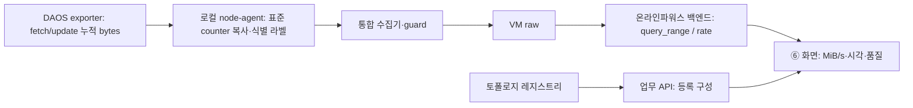

# ⑥ DAOS 처리량 연결 — 2026-11-13.1

실제 DAOS exporter → node-agent → VM → 화면의 읽기·쓰기 연결을 검증했다. 저장 HTML은 과거 실측이고 운영 화면 배포가 아니다. 관측 구간은 **2026-11-13 03:57:25~04:12:25 UTC (12:57:25~13:12:25 KST)**. 2개 노드 × 읽기/쓰기 4시리즈, 각 181개 지점이다. 이 구간은 **유휴 0 B/s**이며 장비 성능·IOPS·지연 검증으로 해석하지 않는다.

## 원천과 역할



| 담당 | 입력/처리 | 현재 확인 범위 |
|---|---|---|
| 글루시스 DAOS exporter | `engine_pool_xferred_fetch`, `engine_pool_xferred_update`; counter, bytes | 실제 값·type·pool/rank/target |
| 글루시스 node-agent | 각각 `gpuflow_storage_target_read_bytes_total`, `gpuflow_storage_target_write_bytes_total`로 값 변경 없이 복사 | 기존 배포 매핑 유지, cluster/node/source/pod·출처 유지 |
| 글루시스 수집·저장 | collector/guard → VM raw | 실측 저장값 대조 |
| 온라인파워스 백엔드·UI | VM 직접 조회; 각 시리즈의 `rate(counter[1m])`, B/s ÷ 1,048,576 → MiB/s | 이번 미리보기로 참조 구현·조회 예제 제공; 온라인파워스 제품 반영은 별도 |
| 토폴로지 | 업무 API의 Pool/Container/rank 등록 자료 | 전체 물리 target/engine 수·건강 상태의 증거 아님 |

`pod`는 장비 구획이다. Kubernetes Pod·테넌트·워크로드에 자동 귀속하지 않는다. 스토리지 전용 필터는 해당 영역에만 적용한다. 원본·표준 counter를 함께 합산하지 않는다. 전체 인벤토리가 없으므로 화면은 관측된 node/rank/target/pool별 값만 표시한다. `backend=daos`, `storage_media=emulated_virtio`, `transport=tcp`인 시험 환경이며 NVMe/RDMA 성능 결과가 아니다.

## VM 조회 예제

주소와 cluster 값은 운영 담당이 전달한 값으로 바꾼다. 샘플 식별자는 치환값이다. 새 제품 API를 추가하지 않는다. 내부 미리보기의 `/testbed-api/storage-series`는 로컬 참조 어댑터일 뿐이다.

```promql
rate(gpuflow_storage_target_read_bytes_total{cluster="example-storage-cluster",source="gluesys",data_origin="measured",simulated="false",backend="daos",job="gpuflow-measured-daos"}[1m])
rate(gpuflow_storage_target_write_bytes_total{cluster="example-storage-cluster",source="gluesys",data_origin="measured",simulated="false",backend="daos",job="gpuflow-measured-daos"}[1m])
```

- `GET <VM raw base>/api/v1/query_range`: `query`, `start`, `end`, `step=5`, `latency_offset=1s`, `nocache=1`.
- 참조값: 끝 시각은 현재−10초를 5초 경계로 내림, 시작은 끝−900초. 모든 조회에 같은 시각을 사용한다.
- 각 방향별 counter 자체, `rate(...[1m])`, `timestamp(counter)`, `count_over_time(counter[1m])`를 조회한다. 총 8개 요청이다. 응답 `data.result[].metric`과 `values=[시각, 문자열 값]`을 동일 라벨·평가 시각으로 연결한다.
- 시리즈당 최대 181지점, 응답당 최대 256시리즈/4MiB, 단일 요청 8초 및 전체 시작 제한 25초(진행 중 마지막 요청 포함 최대 약 33초). 브라우저 timeout 35초. 로컬 어댑터는 성공 결과를 5초 캐시하며 실패 시 이전 성공값으로 대체하지 않는다.
- rate 계산은 VM에 맡긴다. 프런트는 단위만 변환한다. VM `rate`는 구간 이전 마지막 표본을 고려하며 Prometheus와 extrapolation 동작이 다르므로 별도 JS 유한차분식을 동일 알고리즘이라고 주장하지 않는다. [VM rate 설명](https://docs.victoriametrics.com/metricsql/#rate)
- VM의 기본 최근 구간 보정은 약 30초이다. 이번 읽기 요청에서만 `latency_offset=1s`를 명시하고 끝을 최소 10초 이전으로 두었다. J 서버 전역 옵션은 바꾸지 않았다. 최신 구간 불완전 가능성은 아래 품질 검사로 표시한다. [VM query latency](https://docs.victoriametrics.com/victoriametrics/keyconcepts/#query-latency)

제품 갱신 주기·기간별 집계·보존·캐시 TTL은 미정 — 글루시스·온라인파워스 / 화면/API 협의 시 확정. 이 참조 구현의 15분/5초 설정이 전체 제품 조회 계약은 아니다.

## 표시와 품질

| 상태 | 판정·표시 |
|---|---|
| 실제 0 | 유효 rate=0, 원천 시각 차이≤15초, 1분 표본≥2. `0.000000 MiB/s` |
| 미수집/표본 없음 | rate·counter·원천 시각·표본 수 중 누락, 방향 시리즈 없음. `—` |
| 오래된 관측 | 원천 시각이 평가 시각보다 15초 초과 오래됨. live 응답/끝 시각이 현재보다 45초 초과 오래되어도 최신값 숨김 |
| 표본 부족 | 1분 표본 2개 미만. `—` |
| 조회 실패 | 상위 HTTP·형식 오류. 이전 값 표시 안 함 |
| 중복 | 같은 cluster/pod/node/pool/rank/target/source/backend/방향이 복수. 합산 보류 |
| 미연동 | IOPS·지연·용량·건강 상태·Lustre·DPU는 별도 원천/계약 필요 |

차트는 빈 지점을 건너 이어 그리지 않는다. 최신값이 오래되어도 유효한 과거 그래프는 관측 구간과 함께 남긴다. 원천 시각과 샘플 수는 수집 품질 증거이며, 서비스 건강·성능 적합 판정이 아니다. 저장 표본은 열어 본 현재 시각으로 만료시키지 않는다.

## 검증 근거와 한계

- DAOS 원천의 counter type 확인. A/B 각 2회 원천 캡처 × 2방향 = 8건, VM 누적값과 모두 일치. 원천 캡처와 VM 조회 시각은 다르며 동일 시각의 원자적 스냅샷이라고 주장하지 않는다.
- 최신 누적 bytes: A 읽기 754,993,464 / 쓰기 150,996,120; B 읽기 704,643,072 / 쓰기 134,217,728. 15분 rate는 모두 0, 원천 시각 차이는 최댓값 약 0.604초. 실측 차트 724지점과 표시값 확인.
- 증가하는 처리량은 별도 단위 테스트의 명시적 합성값으로만 단위 변환 확인. 부하를 발생시키지 않았으므로 비영(非零) 실제 I/O 구간·counter reset·부하 중 손실률의 인수 검증은 다음 단계다.
- 2026-11-09 배치/등록 표본과 2026-11-13 처리량을 함께 보관하되 각 시각을 별도 표시. 식별자 치환 체계도 다르므로 두 자료의 Pool/노드를 자동 조인하지 않는다.
- GitHub CI는 순수 판정·HTTP 어댑터·문서 정합성·빌드, 로컬 브라우저는 저장/실시간 응답 표시·실패·필터·모바일·기존 13화면을 검증한다. J 상시 서비스/guard/장비 설정은 변경하지 않았다.

다음 실증은 합의된 DAOS 읽기·쓰기 시험을 실행하며 **동일 구간** 원천 counter → VM rate → UI를 대조하는 것이다. 기존 daemon 자원 관측만으로 IOPS·지연·용량을 완료로 처리하지 않는다.
